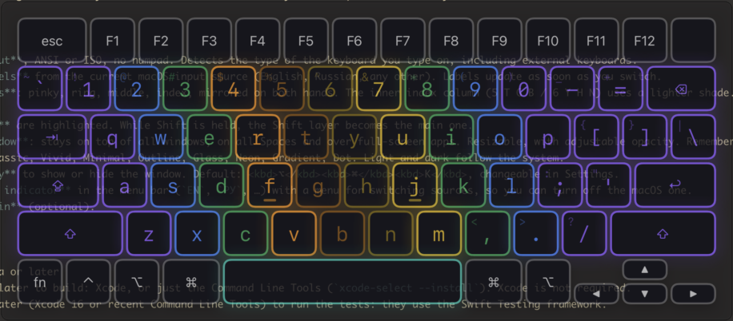

# KeyView

A small macOS menu bar app that shows your keyboard layout in a floating window. Each key is colored by the finger that should press it.



> [!WARNING]
> This code was written entirely by an LLM (Claude) and has **not been reviewed by a human**.
> It may contain bugs or security issues. Read the code before you run it, and use it at your own risk.

## Features

- **MacBook layout**, ANSI or ISO, no numpad. Detects the type of the keyboard you type on, including external keyboards.
- **Live key labels** from the current macOS input source (English, Russian, any other). Labels update as soon as you switch.
- **Finger colors**: pinky, ring, middle, index, mirrored on both hands. The inner index column (5 T G B / 6 Y H N) uses a lighter shade. F and J show their tactile bumps.
- **Pressed keys** are highlighted. While Shift is held, the Shift layer becomes the main one.
- **Floating window**: stays on top of all windows, on all Spaces and over full-screen apps. Resizable, with adjustable opacity. Remembers its position and size.
- **Themes**: Classic, Vivid, Minimal, Outline, Glass, Neon, Gradient, Dot. Light and dark follow the system.
- **Global hotkey** to show or hide the window. Default: <kbd>⌥</kbd><kbd>⌘</kbd><kbd>K</kbd>, changeable in Settings.
- **Input source indicator** in the menu bar (`EN`, `РУ`, …) with a menu for switching sources, so you can turn off the macOS one.
- **Start at login** (optional).

## Requirements

- macOS 14 Sonoma or later
- Swift 5.10 or later to build: Xcode, or just the Command Line Tools (`xcode-select --install`). Xcode is not required.
- Swift 6.0 or later (Xcode 16 or recent Command Line Tools) to run the tests: they use the Swift Testing framework.

## Installation

There are no prebuilt binaries. Build the app from source:

```sh
git clone https://github.com/v3111707/keyview.git
cd keyview
./build.sh
cp -R build/KeyView.app /Applications/
open /Applications/KeyView.app
```

`build.sh` runs `swift build -c release`, packs the binary into `build/KeyView.app`, and signs it ad hoc. The app is built on your own Mac, so Gatekeeper does not block it.

Put the app in `/Applications` if you want to use **Start at login**.

### Permissions

KeyView asks for **Input Monitoring** on first launch. It needs it to highlight pressed keys and show the Shift layer. Without it the app still works, just without highlighting.

To grant it later: **System Settings → Privacy & Security → Input Monitoring**, turn on **KeyView**, then restart the app.

Every rebuild changes the ad-hoc signature, so the old grant no longer matches. `build.sh` resets it, and macOS asks again on the next launch.

The global hotkey needs no permission.

## Usage

KeyView has no Dock icon. Use the menu bar icon:

- **Show/Hide** the keyboard window (or press <kbd>⌥</kbd><kbd>⌘</kbd><kbd>K</kbd>)
- **Opacity** slider
- **Settings**
  - *General*: start at login, hotkey, input source indicator in the menu bar
  - *Themes*: key style, separate shades for left and right index fingers, background transparency
- **Quit**

## Development

```sh
swift build
swift test
```

With only the Command Line Tools installed (no Xcode), run tests with:

```sh
swift test -Xswiftc -plugin-path -Xswiftc /Library/Developer/CommandLineTools/usr/lib/swift/host/plugins/testing
```

The intended behavior is described in [SPEC.md](SPEC.md).

## Uninstall

1. Quit KeyView from the menu bar.
2. Delete `/Applications/KeyView.app`.
3. Optionally remove the permission and settings:

   ```sh
   tccutil reset ListenEvent local.keyview
   defaults delete local.keyview
   ```

## License

[MIT](LICENSE)
